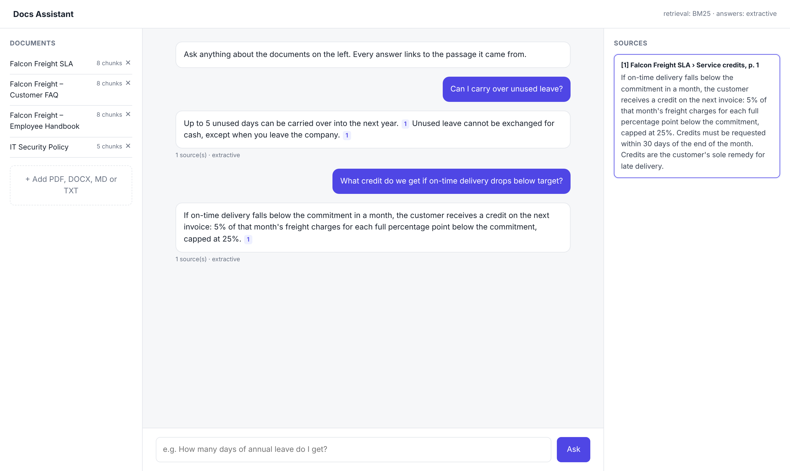

# Docs RAG Assistant

A chatbot that answers questions from your company's own documents (PDF, Word, Markdown) and shows the exact passage behind every answer.



## What it does

- **Ingests PDF, DOCX, MD and TXT**, keeping each section's heading attached to its text. A chunk that says "up to 5 days can be carried over" is far easier to find and cite when it also carries "Annual leave".
- **Hybrid retrieval:** BM25 keyword search always runs, and OpenAI embeddings are added when a key is set. The two rankings are merged with reciprocal rank fusion. Keyword search catches exact terms like amounts, plan names and codes; embeddings catch paraphrases.
- **Cited answers:** with an LLM configured (OpenAI or Anthropic), the model must cite source numbers. If it cites a source that wasn't retrieved, or cites nothing, the answer is dropped and an extractive answer is returned instead.
- **Works without any API key:** extractive mode returns the best-matching sentences from the top passages, with citations.
- **Says when it doesn't know** instead of guessing ([screenshot](docs/chat.png)).
- **Upload and remove documents** from the UI. Unchanged files are skipped on re-index (SHA-256).
- **Evaluation script** with 30 questions that checks both retrieval (hit@1, hit@3) and whether the answer contains the right fact.

## Architecture

```
            ┌──────────── ingest ────────────┐
 files ──► loaders ──► sections ──► chunker ──► SQLite (chunks + embeddings)
 (pdf/docx/md)        (heading, page)    (≈700 chars, 1-sentence overlap)

 question ──► BM25 ─┐
          └─► embed ┴─► RRF fusion ──► relevance check ──► LLM w/ citations ──► citation check ──► answer
                                             │                     └─ fails ──► extractive answer
                                             └─ too weak ──► "couldn't find this"
```

## Quick start

```bash
pip install -r requirements.txt
uvicorn rag.app:app --reload        # http://127.0.0.1:8000, indexes sample_docs/ on startup
```

From the command line:

```bash
python -m rag ingest sample_docs
python -m rag ask "What is the maximum service credit?"
python -m rag search "lost laptop"
```

To turn on embeddings and generated answers:

```bash
export OPENAI_API_KEY=sk-...
export LLM_PROVIDER=openai          # or anthropic + ANTHROPIC_API_KEY
```

Docker: `docker build -t docs-rag . && docker run -p 8000:8000 -v rag-data:/data docs-rag`

## Evaluation

```bash
python eval/run_eval.py
```

| Setup | hit@1 | hit@3 | answer contains expected fact |
|---|---|---|---|
| BM25 only, extractive answers | 0.97 | 1.00 | 1.00 |

The question set is small (30 questions over 4 documents) and I wrote it alongside the documents, so treat these numbers as a regression check rather than a benchmark. It runs in CI so retrieval changes can't quietly make things worse. For a real deployment, I'd build the question set from actual employee or customer questions.

## Known limitations

- In keyword-only mode, out-of-scope detection is a heuristic based on BM25 score and query-term coverage. A question that shares a key word with the docs (e.g. "gym" vs "Is there a gym in the office?") can still get an unrelated passage. Embeddings plus an LLM handle this better, because the model can answer `NOT_FOUND`.
- Scanned PDFs need OCR first; `pypdf` only reads PDFs that contain text.
- Embeddings are kept in SQLite and searched in memory. That's fine for a few thousand chunks. Beyond that, I'd switch to pgvector or Qdrant.

## Layout

```
rag/
  loaders.py     PDF / DOCX / Markdown → sections with headings and page numbers
  chunking.py    sentence-aware chunking with overlap
  bm25.py        keyword index + query coverage
  embeddings.py  OpenAI embeddings (optional)
  store.py       SQLite index, change detection
  retriever.py   hybrid search with reciprocal rank fusion
  answer.py      relevance gate, LLM answers + citation check, extractive fallback
  app.py         FastAPI: /api/ask, /api/search, /api/documents
web/index.html   chat UI (no build step)
eval/            question set + scorer
sample_docs/     fictional company documents used for the demo
```

---

Built by [Usman Saleem Bhatti](https://www.upwork.com/freelancers/~017ac7683856df4451). The sample company and documents are fictional.
